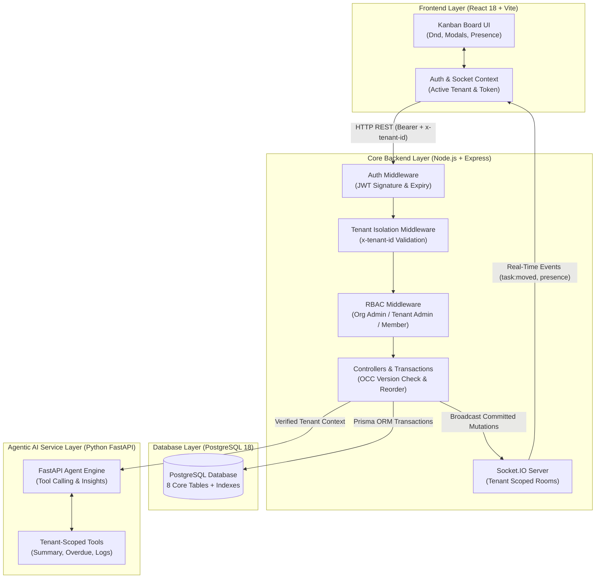

# JulleyOnline — System Architecture & Design Document

## 1. System Architecture Overview



---

## 2. Multi-Tenancy Data Isolation Model

### Architectural Strategy: Shared Database, Pooled Schema with Discriminator Key
In this application, all tenants share a unified PostgreSQL database and schema, with strict data isolation enforced at the logical, middleware, and query levels:
1. **Mandatory Foreign Key:** Every tenant-owned business record (`tenants`, `boards`, `columns`, `tasks`, `activity_logs`) possesses a mandatory `tenant_id` column.
2. **Double Validation:** When an API request arrives, the backend does not rely on URL parameters or client-supplied bodies. Instead:
   - The user's verified identity is decoded from the signed JWT.
   - The user's authorized memberships are retrieved from the database.
   - The requested `x-tenant-id` header is verified against authorized memberships.
   - If unauthorized, access is immediately blocked with `HTTP 403 Forbidden`.
3. **Database Query Scoping:** Every Prisma query explicitly includes `where: { tenantId }`.

---

## 3. Optimistic Concurrency Control (OCC)

To prevent simultaneous edits from silently overwriting one another:
1. Every task entity contains a `version: INTEGER` column (starts at `1`).
2. When a user opens or drags a task, the client submits `expectedVersion`.
3. The server executes:
   ```sql
   UPDATE tasks
   SET title = $1, version = version + 1
   WHERE id = $2 AND tenant_id = $3 AND version = $4;
   ```
4. If `version !== expectedVersion`, the server aborts the transaction and returns `HTTP 409 Conflict` along with the latest server task data.
5. The frontend displays a conflict resolution banner allowing the user to reload the latest server state without losing data.

---

## 4. Architectural Trade-offs Analysis

| Architectural Choice | Advantages | Trade-offs & Limitations |
|---|---|---|
| **PostgreSQL (ACID Database)** | Guarantees transactional consistency for complex task reordering and audit log generation in a single commit. | Requires relational schema migrations; higher connection overhead than NoSQL for pure read-heavy caches. |
| **Prisma ORM** | Type-safe schema definition, automatic migration tracking, and interactive transactions. | Adds slight runtime abstraction over raw SQL queries. |
| **Socket.IO (WebSockets)** | Built-in room management (`tenant:${id}`), reconnection logic, and heartbeat presence tracking. | Stateful connections require sticky sessions or Redis pub/sub adapter when horizontally scaling to multiple backend instances. |
| **JWT (JSON Web Tokens)** | Stateless authentication reduces database session lookup load on frequent requests. | Revocation before expiration requires a token blocklist in Redis. |
| **Version-Based OCC** | Simple, reliable, zero-deadlock concurrency strategy compared to heavy distributed pessimistic row locking. | In high-frequency collaborative editing (e.g., Google Docs), OCC causes frequent 409 retries; for task cards, OCC is the industry standard. |
| **Python FastAPI AI Agent** | Decouples intelligent analysis from the core transactional Node.js backend. Leverages Python's data analysis and LLM ecosystem. | Requires maintaining two separate backend runtime environments (Node + Python). |
