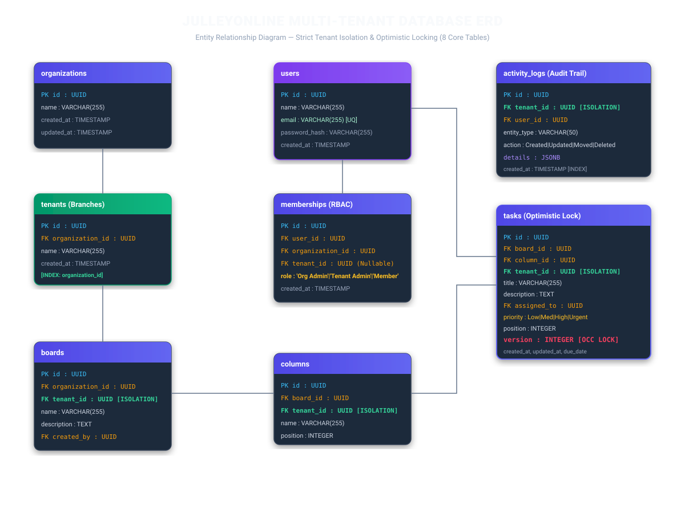
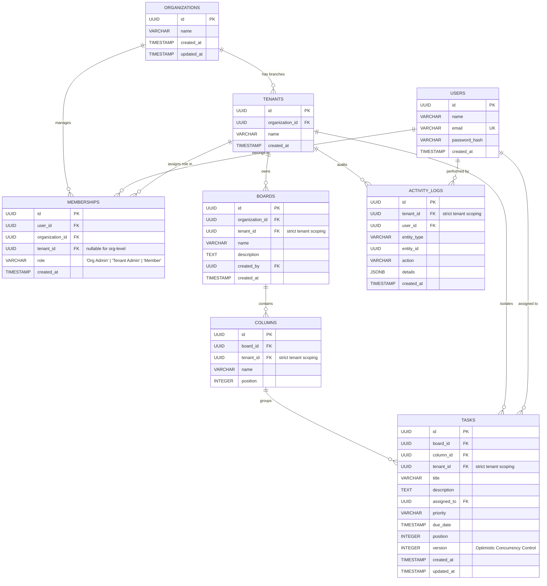

# JulleyOnline — Multi-Tenant Database ER Diagram

## Overview
This document presents the complete Entity-Relationship Diagram for the multi-tenant real-time collaborative Kanban system. The data model enforces strict data isolation at the branch/tenant level, role-based access control, and optimistic concurrency locking.

---

## Mermaid Entity-Relationship Diagram

---

## The 8 Core Tables

### 1. `organizations`
Stores top-level enterprise companies (e.g., *ABC Technologies*, *XYZ Solutions*).

### 2. `tenants`
Stores independent branches/workspaces belonging to an organization (e.g., *Hyderabad*, *Bangalore*, *Chennai*, *Mumbai*, *Pune*).

### 3. `users`
Stores registered employees and credentials. Passwords are encrypted with bcrypt (10 rounds). Plain text passwords are never stored.

### 4. `memberships`
Establishes user permissions across organizations and tenants. Enforces RBAC with three levels:
- **Org Admin**: Full control over organization, branches, and tenant assignments.
- **Tenant Admin**: Manage boards, columns, and team members within their specific branch.
- **Member**: Create, edit, and move tasks within authorized boards.

### 5. `boards`
Stores project Kanban workspaces. Foreign key `tenant_id` guarantees isolation.

### 6. `columns`
Stores task status stages (*To Do*, *In Progress*, *Testing*, *Done*). Ordering maintained by `position`.

### 7. `tasks`
Stores work items with:
- `tenant_id`: Mandatory tenant isolation key.
- `version`: Integer incremented on every move or edit. Enables Optimistic Concurrency Control (OCC) and prevents silent overwrite conflicts (HTTP 409).
- `position`: Server-authoritative ordering index.

### 8. `activity_logs`
Historical audit trail of all mutations (`Created`, `Updated`, `Moved`, `Deleted`). Includes actor `user_id`, timestamp, and metadata payload in JSONB.
